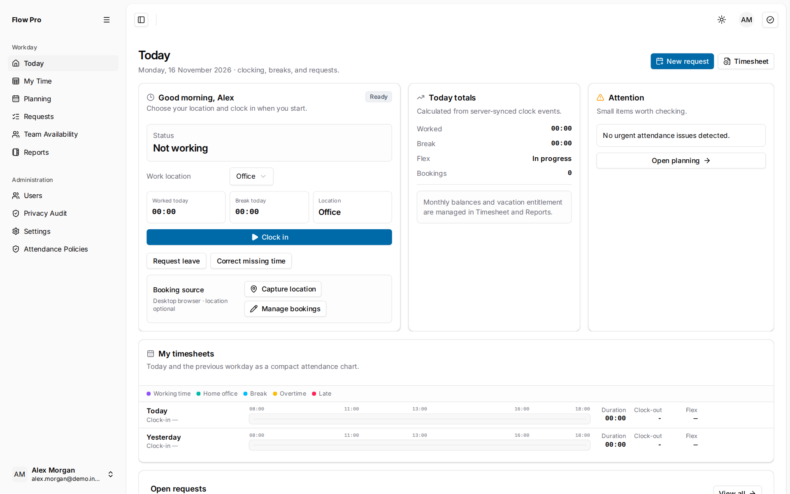
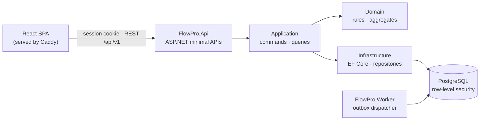

# FlowPro

[](https://github.com/farrukhinomov/flow-pro/actions/workflows/ci.yml)


[](LICENSE)

Multi-tenant workforce operations for small and mid-sized German companies:
time tracking, absence requests, monthly timesheets, team planning, payroll
preparation and a privacy audit trail, in English and German.

A public demo with one-click sign-in for each role is on its way. Until then,
the [quick start](docs/self-hosting/quick-start.md) runs the whole stack
locally with Docker.



## What It Shows

| Area | Highlights |
| --- | --- |
| **Architecture** | .NET 10 modular monolith with Domain / Application / Infrastructure / API layers, enforced by architecture tests. Lightweight CQRS without MediatR ([why a modular monolith](docs/architecture/backend/modular-monolith.md), [why lightweight CQRS](docs/architecture/backend/lightweight-cqrs.md)). |
| **Multi-tenancy** | Every tenant-owned row is protected by PostgreSQL **row-level security**, not only by `WHERE tenant_id = …` in application code. |
| **Reliability** | Transactional **outbox** with a separate worker (`FOR UPDATE SKIP LOCKED`), idempotency keys on commands, append-only audit events. |
| **Security** | Built-in accounts with server-side sessions in HttpOnly cookies (no tokens in the browser), optional two-step sign-in with any authenticator app and recovery codes, cross-site request protection, permission-based authorization policies, rate limiting and lockout, RFC 7807 problem details, NuGet vulnerability audit as a build gate. |
| **Domain** | German public holidays per federal state, workspace time zones, attendance policies with effective dates and history, immutable timesheet snapshots. |
| **Frontend** | React + TypeScript, TanStack Router/Query, shadcn/Radix UI, offline-capable IndexedDB cache and sync outbox, full EN/DE i18n, accessibility live regions. |
| **Quality** | Backend unit and architecture tests, database tests that prove tenant isolation against a real PostgreSQL, frontend unit tests, Playwright e2e against the real API (sign-in, invitations, two-step sign-in, the public demo), a visual QA sweep across 3 viewports, and a first-paint performance budget — all in CI. |

## Architecture



```text
.
├── apps/
│   ├── web/                        React + TypeScript SPA
│   │   ├── src/domain/             Pure business rules, no React
│   │   ├── src/features/           Screens and feature components
│   │   ├── src/data/               API clients, IndexedDB cache, sync engine
│   │   └── e2e/                    Playwright suites (functional, visual, performance)
│   └── api/
│       ├── src/FlowPro.Domain          Entities and invariants, no dependencies
│       ├── src/FlowPro.Application     Use cases (CQRS handlers), ports
│       ├── src/FlowPro.Infrastructure  EF Core, PostgreSQL, outbox, audit
│       ├── src/FlowPro.Api             HTTP endpoints, auth, problem details
│       ├── src/FlowPro.Worker          Background outbox dispatch
│       └── tests/                      Domain, application and architecture tests
├── docker/                         Dockerfiles, Caddy and service configuration
├── docs/                           Self-hosting, contributing and architecture guides
├── infra/                          Oracle Cloud server as code, deploy and backup scripts
├── scripts/                        Backup and restore
├── compose.yaml                    The whole stack on one machine
└── Taskfile.yml                    One entry point for common commands
```

## Run It

The whole stack runs with one command. You need a container runtime with
Compose support, such as Docker Engine or Podman.

```bash
docker compose up --build
```

Open <http://localhost:8088> and sign in with `founder@flowpro.local` /
`superadmin`. These are local defaults with seeded demo data; see the
[quick start](docs/self-hosting/quick-start.md) and
[public deployment](docs/self-hosting/public-deployment.md) guides.

## Develop

Requirements: a container runtime, .NET SDK 10.0.404 or later 10.0, Node 22.13+, and
optionally [Task](https://taskfile.dev).

```bash
task setup      # install dependencies
task dev:api    # PostgreSQL in a container, API on http://localhost:5123
task dev:web    # web app on http://localhost:5173
task check      # everything CI checks, except the browser tests
```

Each task is a thin wrapper; `Taskfile.yml` shows the underlying commands.
API reference (Scalar) is at `http://localhost:5123/scalar` in Development.

More: [getting started](docs/contributing/getting-started.md) ·
[documentation home](docs/README.md).

## Tests

```bash
cd apps/web && npm run check        # lint, typecheck, unit tests, build
cd apps/web && npm run test:e2e     # Playwright against the real API
cd apps/api && dotnet test FlowPro.slnx
```

## Deployment

FlowPro deploys as one Docker Compose stack on a single server. Caddy serves
the web app, proxies the API and manages TLS certificates. Images for amd64 and
arm64 are published to GitHub Container Registry on every release. See
[public deployment](docs/self-hosting/public-deployment.md) and, for a free
Oracle Cloud server defined as code, [infra/README.md](infra/README.md).

## Documentation

- [Backend architecture](docs/architecture/backend/architecture.md) and
  [authentication](docs/architecture/backend/auth.md)
- [Frontend architecture](docs/architecture/frontend/architecture.md) and
  [sync engine](docs/architecture/frontend/sync-engine.md)
- [API contracts](docs/architecture/api-contracts.md)
- [Self-hosting quick start](docs/self-hosting/quick-start.md)
- [Self-hosting quick start](docs/self-hosting/quick-start.md)
- [Release checklist](docs/contributing/release-checklist.md)

## Credits

The admin UI shell (layout, sidebar, theming) started from the open-source
[shadcn-admin](https://github.com/satnaing/shadcn-admin) template (MIT). Domain
logic, backend, sync engine and workflows are original work.

## License

FlowPro is free software under the
[GNU Affero General Public License v3.0](LICENSE). You can run, study and modify
it, including for commercial use. If you offer a modified version to others over
a network, you must make your changes available under the same licence.

© Farrukh Inomov and contributors.

## Contributing

Contributions are welcome. Read [CONTRIBUTING.md](CONTRIBUTING.md) first; it
covers the development setup, the dependency licence policy and the contributor
licence agreement. Report security issues as described in
[SECURITY.md](SECURITY.md).
